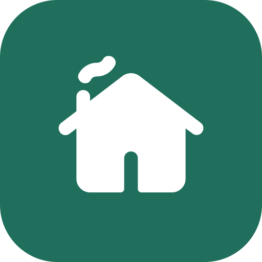

<p align="center">
  
</p>

<h1 align="center">Collabitat</h1>

<p align="center">Split costs, rotate chores and plan meals with the people you live with.</p>

<p align="center">
  <a href="https://github.com/fly-die/collabitat-web/actions/workflows/ci.yml"></a>
  <a href="https://sonarcloud.io/summary/new_code?id=fly-die_collabitat-web"></a>
</p>

Live: [fly-die.github.io/collabitat-web](https://fly-die.github.io/collabitat-web/)  
Backend: [collabitat-api](https://github.com/fly-die/collabitat-api)

## Install on your phone

Open the live link, then:

- **iPhone (Safari):** Share, then Add to Home Screen.
- **Android (Chrome):** menu, then Install app.

## Run locally

Requires Node 24+.

```sh
npm install
npm run dev
```

Open `http://localhost:5173`.

## Scripts

| Command | Purpose |
|---|---|
| `npm run dev` | Start dev server |
| `npm test` | Run tests |
| `npm run test:coverage` | Run tests with coverage |
| `npm run lint` | Lint |
| `npm run build` | Production build |

## Stack

React, TypeScript, Vite, vite-plugin-pwa, Vitest.

## License

[MIT](LICENSE). Logo uses the "cottage" icon from [Material Symbols](https://github.com/google/material-design-icons) (Apache 2.0). Font: [Atkinson Hyperlegible](https://www.brailleinstitute.org/freefont/) (OFL).
